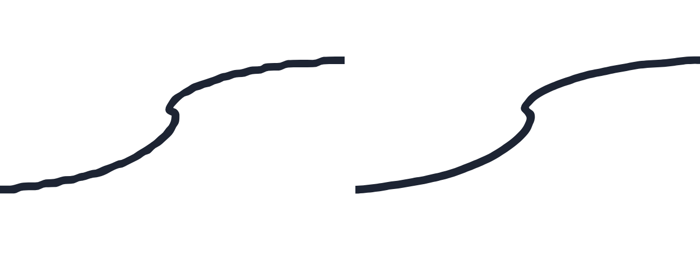

# Netteté des traits : diagnostic et correction (11/11/2026, 4ᵉ lot)

Symptôme signalé : traits « granuleux », contours irréguliers, manque de netteté.

## Diagnostic mesuré

| Piste examinée | Mesure | Conclusion |
| --- | --- | --- |
| Géométrie du contour avec des coordonnées **précises** | Écart du bord à la forme idéale : 0,003 unité (droite, cercle, 3 vitesses) | Pas en cause |
| Coordonnées **arrondies au pixel** (Safari les fournit ainsi pour le stylet ; Chrome les donne avec décimales) | Écart du bord : jusqu'à **0,5 unité** (0,14 à 0,19 en moyenne) pour un trait de 2,2 d'épaisseur ; ondulation mesurée à l'écran : 0,33 à 1,3 px selon le zoom | **Cause principale** : le tracé devient un escalier de 1 px, et le contour, calculé perpendiculairement à la direction locale, ondule |
| Ancien lissage (avant le 2ᵉ lot) | Même défaut, parfois pire (jusqu'à 1 unité) | Ne corrigeait pas l'escalier |
| Position des canvas | Fenêtre de zoom placée **entre deux pixels physiques** : 1618,81 px sur iPad, 1823,44 px sur iPhone | **Cause du flou dans la fenêtre de zoom** (l'image entière est rééchantillonnée) |
| Taille des canvas | Densité non entière (1,25) : canvas de 558 px pour 557,5 px affichés | Léger flou général sur ces écrans |
| `devicePixelRatio` sur iPad et iPhone (2 et 3) | Page principale alignée et à la bonne taille | Pas en cause pour la page principale |
| Anticrénelage | Remplissage vectoriel antialiasé (Canvas 2D), aucun `image-rendering` | Pas en cause |
| Texture | Grain uniquement sur le **crayon**, mais d'une taille fixe sur la page, donc de gros pavés flous en zoom | Grain mal dimensionné, mais propre au crayon |

Source sur l'arrondi des coordonnées dans Safari : [webkit.org/b/133180](https://webkit.org/b/133180),
[bug WebKit 242189](https://lists.webkit.org/pipermail/webkit-unassigned/2022-June/1042879.html),
[intention Mozilla (2024)](https://groups.google.com/a/mozilla.org/g/dev-platform/c/eXuAe5aDsLU).

## Corrections

1. **Lissage spatial au rendu** (`src/ink/smooth.ts`), sans toucher aux points enregistrés :
   - rééchantillonnage à pas régulier, puis régression locale quadratique ;
   - grande fenêtre sur les parties droites, ce qui efface l'escalier ;
   - petite fenêtre dans les courbes, ce qui préserve les boucles des lettres et les angles ;
   - pression lissée sur ±2 échantillons seulement.

   Les extrémités restent exactes, donc **aucune latence** : la fin du trait reste sous la pointe. Chaque trait garde sa
   résolution de saisie (`style.res`). Si le navigateur arrondit les coordonnées, l'échelle de lissage est d'un pixel de
   saisie ; sinon elle est trois fois plus fine. Dans la fenêtre de zoom, elle est donc 2,5 fois plus fine sur la page.
   Les formes nettes ne sont pas lissées. Les traits existants profitent du rendu adouci avec une valeur par défaut, et
   leurs données ne changent pas.
2. **Canvas calés sur la grille de pixels physiques** (page et fenêtre de zoom) : le coin du canvas tombe sur un pixel
   entier, le dessin est décalé de la fraction restante, et la taille du canvas correspond exactement à la taille
   affichée, y compris pour une densité non entière.
3. **Grain du crayon** : toujours réservé au crayon, mais fin (≈ 1,3 px physique) à tout zoom et ancré à la page.
4. **Export de la page en PNG** (menu Plus) : même moteur et même lissage que l'écran, rendu directement à 3 px par
   unité de page, environ 290 ppp pour un A4.

## Ce qui a été réellement testé

Environnement : Linux, Chromium sans affichage (headless), stylet simulé. **Aucun essai sur iPad ni avec un Apple Pencil réel.**

| Vérification | Résultat |
| --- | --- |
| [auto] Bord du trait, coordonnées arrondies, droite lente | 0,19 → 0,035 unité en moyenne, max 0,51 → 0,16 |
| [auto] Cercle arrondi au pixel | 0,066 → 0,021 unité |
| [auto] Coordonnées précises | Inchangé (≤ 0,15 unité sur la ligne médiane, bord ≤ 0,05) |
| [auto] Petite boucle de lettre (rayon 4) | Écart moyen < 0,1 unité |
| [auto] Angle de 60° | Sommet déplacé de moins d'un demi-pixel de saisie |
| [auto] Pression | Amplitude conservée à plus de 90 % |
| [auto] Extrémités | Exactes |
| [auto] Coût | ≈ 0,3 ms pour un trait de 400 points ; borné pour les très longs traits |
| [auto] Ondulation mesurée **sur les pixels affichés** (droite lente, coordonnées entières, densité 2), comparée au même trait sans lissage | Zoom 1 : 0,33–0,42 → 0,09–0,11 px ; zoom ×3 : 1,0–1,3 → 0,25–0,33 px ; fenêtre de zoom : 0,81–1,10 → 0,22–0,28 px |
| [auto] Après rechargement | Même mesure qu'avant (± 0,05 px) |
| [auto] Export PNG | Dimensions = 3 × la page ; ondulation 0,08–0,18 px |
| [auto] Alignement des canvas aux densités 2, 3 et 1,25, fenêtre de zoom ouverte | Écart < 0,05 px physique (précision interne de la mise en page) |
| [auto] Grain | Bille unie (écart-type < 2), crayon texturé, grain fin à ×4 (corrélation à 3 px < 0,35) |
| [auto] Tests existants | Précision du tracé, absence de saut au lever, six stylos, etc. : tous verts |

## À valider sur votre iPad
- Netteté perçue au Pencil et au doigt, à plusieurs zooms et dans la fenêtre de zoom (scénarios 41 à 45 de
  [IPAD.md](IPAD.md)).
- Si votre version de Safari fournit déjà des coordonnées avec décimales, Calame le détecte et lisse moins ; le
  résultat doit être net dans les deux cas.
